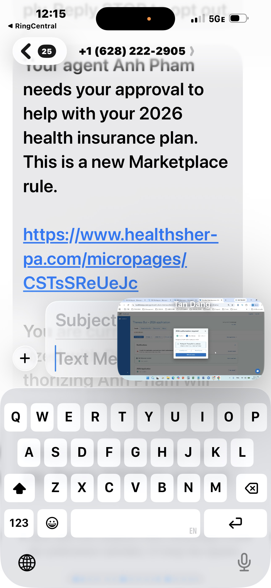
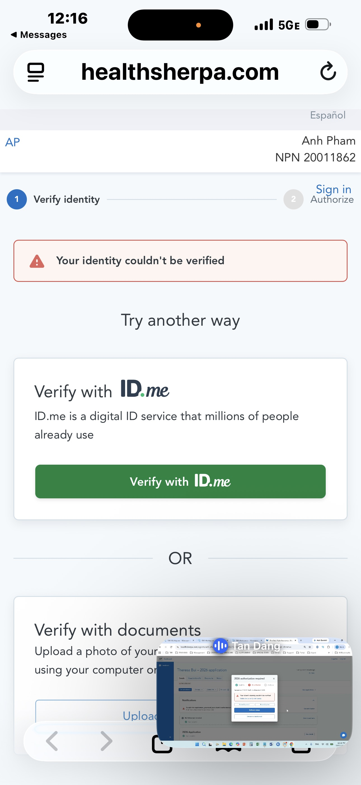
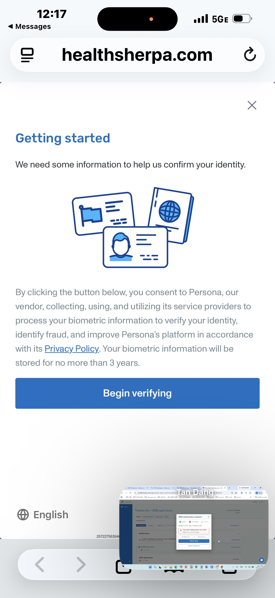
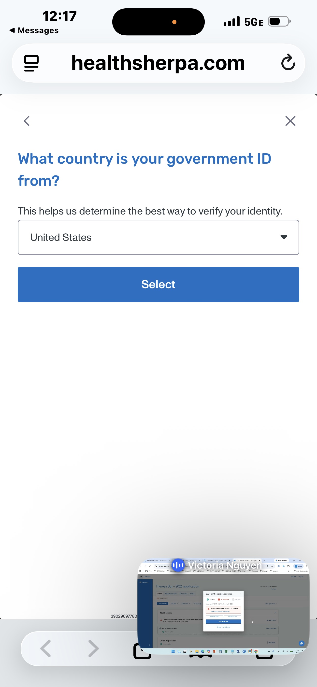
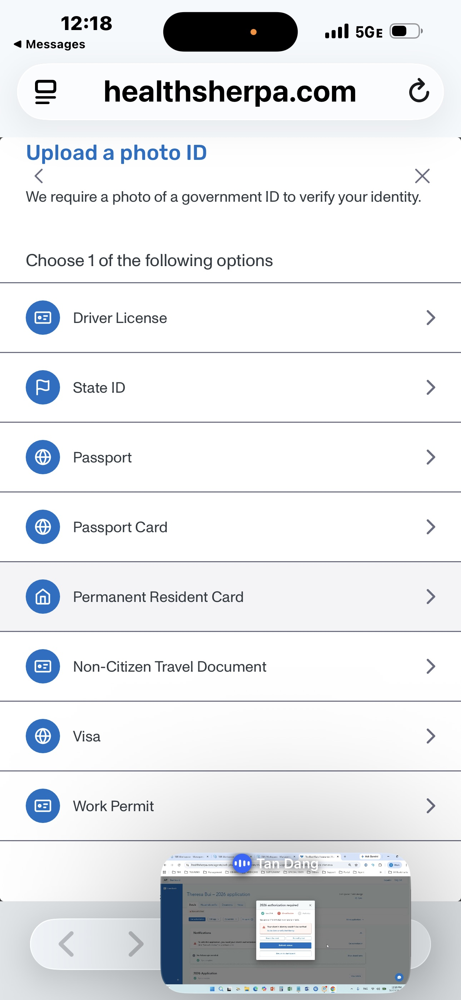
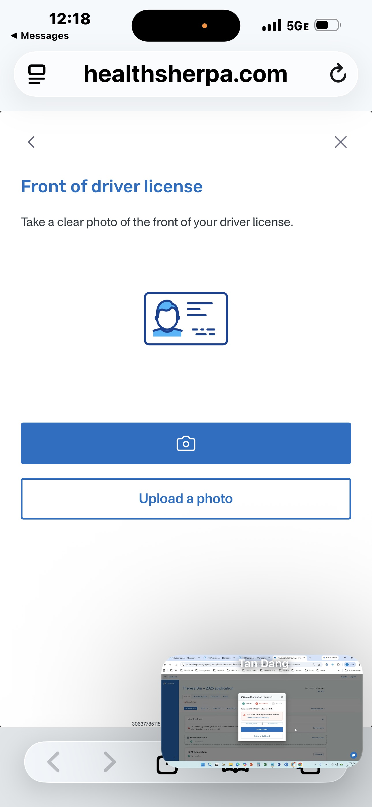
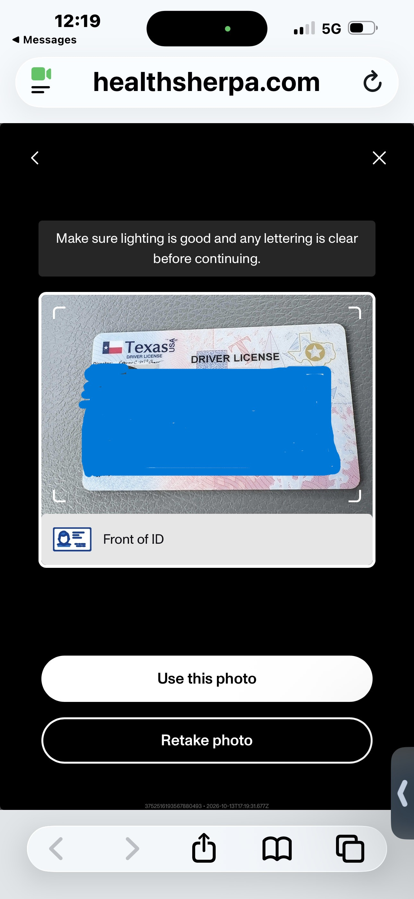
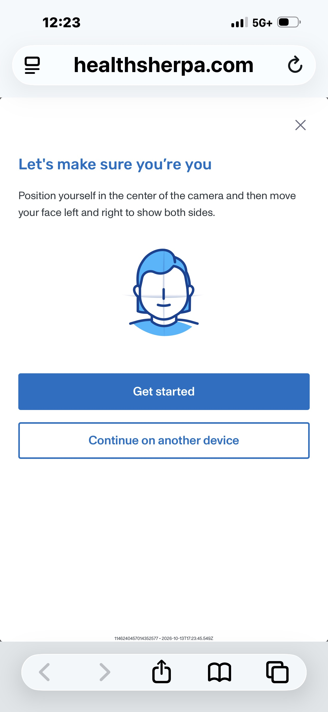
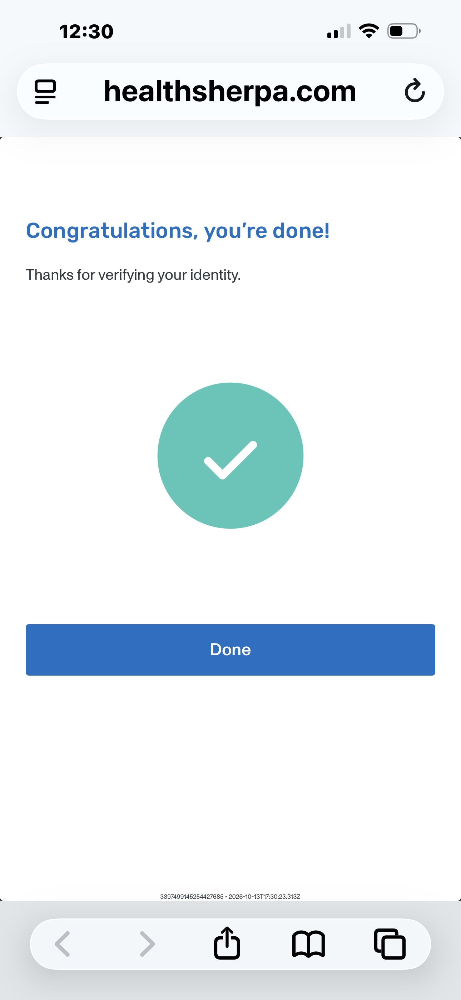
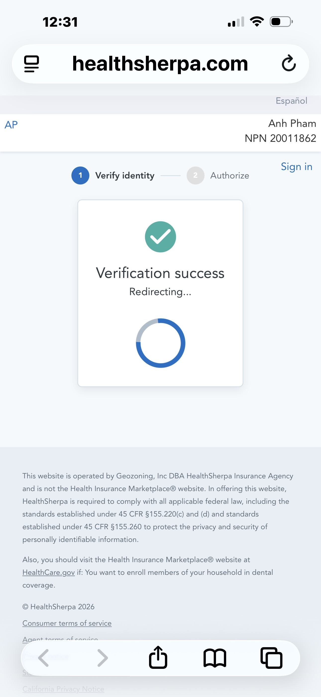

# QUY TRÌNH XÁC THỰC ỦY QUYỀN ĐẠI LÝ (AGENT AUTHORIZATION) TRÊN HEALTHSHERPA

**Đơn vị ban hành:** The Best Rate Insurance (TBR)  
**Phạm vi áp dụng:** Toàn bộ Đội ngũ Sale Support, Agent và Ban Quản Lý Nghiệp Vụ  
**Căn cứ pháp lý:** Quy định an toàn bảo mật bắt buộc của Trung tâm Dịch vụ Medicare & Medicaid Hoa Kỳ (CMS) áp dụng cho sàn liên bang ACA/Obamacare từ mùa ghi danh 2026 – 2027.

---

## I. TỔNG QUAN & BỐI CẢNH QUY ĐỊNH CMS 2026 – 2027

Kể từ ngày 12/10/2026, CMS siết chặt toàn diện quy trình kiểm soát quyền đại diện trên thị trường bảo hiểm y tế cá nhân (ACA). Tất cả các nền tảng ghi danh trực tuyến được liên kết liên bang, bao gồm HealthSherpa, đều triển khai cơ chế bắt buộc: **Chỉ khi người tiêu dùng (khách hàng đứng đơn) thực hiện xác thực điện tử và phê duyệt ủy quyền, Đại lý hoặc Chuyên viên hỗ trợ (Support) mới được phép truy cập, tra cứu thông tin, điều chỉnh hồ sơ hoặc ghi danh gói bảo hiểm mới.**

Cơ chế này nhằm ngăn chặn tình trạng hồ sơ bị tự ý chuyển đổi đại lý (AOR flip) trái phép hoặc bị sửa đổi thông tin không qua kiểm duyệt. Để vận hành trơn tru mùa cao điểm, toàn thể nhân sự công ty cần nắm vững 2 quy trình xác thực thực tế mà khách hàng sẽ trải qua trên điện thoại.

---

## II. QUY TRÌNH CÁCH 1: XÁC THỰC NHANH TIÊU CHUẨN (STANDARD 1-CLICK APPROVAL)

### 1. Điều kiện áp dụng
Quy trình này xuất hiện khi hồ sơ khách hàng đạt độ tin cậy tuyệt đối theo thuật toán đối soát tự động của CMS:
* Số điện thoại nhận tin nhắn trùng khớp với thông tin thuê bao chính chủ viễn thông của người đứng đơn.
* Dữ liệu định danh (Họ tên, Ngày sinh, Địa chỉ, Số An sinh Xã hội SSN) khớp hoàn toàn với hồ sơ trên cơ sở dữ liệu Marketplace.
* Hồ sơ khách hàng tái tục (Renew) cùng Agent, không có tranh chấp quyền đại diện.

### 2. Các bước triển khai thực tế

* **Bước 1 (Gửi yêu cầu):** Support mở hồ sơ khách hàng trên HealthSherpa. Khi thanh thông báo xuất hiện nội dung *"To edit this application, you need your client's authorization"*, Support nhấn nút **"Get authorization"** để hệ thống gửi tin nhắn SMS tự động.
* **Bước 2 (Khách nhận tin nhắn):** Khách hàng nhận được tin nhắn từ đầu số chính thức **+1 (628) 222-2905** chứa nội dung giải thích quy định của Marketplace kèm theo đường liên kết bảo mật (micropage). Đường liên kết này có hiệu lực đếm ngược trong vòng 15 phút.
* **Bước 3 (Xác nhận phê duyệt):** Khách hàng nhấp vào đường link trên điện thoại. Màn hình hiển thị đầy đủ tên Đại lý và mã số định danh quốc gia (NPN). Khách hàng chỉ cần nhấn nút **"Authorize"** (hoặc Approve).
* **Bước 4 (Mở khóa trên hệ thống):** Ngay sau khi khách bấm xác nhận, Support tại văn phòng nhấn nút **"Refresh status"** trên màn hình HealthSherpa. Hộp thoại thông báo chuyển sang màu xanh với dòng chữ **"Authorized"**, cho phép Support toàn quyền xử lý hồ sơ.

*Ghi chú Hình 1: Bên trái là giao diện tin nhắn SMS từ đầu số +1 (628) 222-2905 gửi đến máy khách hàng. Bên phải là màn hình chờ đếm ngược và trạng thái khóa hồ sơ trên HealthSherpa của Agent/Support.*

---

## III. QUY TRÌNH CÁCH 2: XÁC THỰC DANH TÍNH MỞ RỘNG (HIGH-RISK IDENTITY VERIFICATION)

### 1. Nguyên nhân kích hoạt trạng thái xác thực nâng cao
Trong trường hợp hệ thống CMS hoặc HealthSherpa phát hiện các dấu hiệu rủi ro danh tính, khách hàng sẽ không thể phê duyệt bằng 1 chạm mà bị chuyển sang màn hình cảnh báo kiểm tra nghiêm ngặt:
* Số điện thoại đăng ký là số trả trước (Prepaid), số điện thoại ảo (VoIP), hoặc không đứng tên chính chủ khách hàng.
* Khách hàng mới chuyển từ đại lý bên ngoài về The Best Rate Insurance (đổi AOR).
* Hồ sơ có mức trợ cấp phí bảo hiểm tối đa ($0 Premium) hoặc thay đổi địa chỉ cư trú sang tiểu bang khác.

Khi nhấp vào link SMS, màn hình điện thoại khách hàng lập tức hiển thị thông báo lỗi:  
**"Your identity couldn't be verified. Try another way"**  
Hệ thống cung cấp 2 tùy chọn giải quyết: **Verify with ID.me** hoặc **Verify with documents**.

*Ghi chú Hình 2: Khi xuất hiện màn hình này, hệ thống máy tính của Agent cũng sẽ hiển thị cảnh báo: "Your client's identity couldn't be verified. Guide client to verify their identity". Support cần bình tĩnh hướng dẫn khách hàng thực hiện theo Phương án 2A (Chủ lực) hoặc Phương án 2B.*

---

### 2. PHƯƠNG ÁN 2A (QUY TRÌNH CHỦ LỰC): CHỤP GIẤY TỜ & QUÉT KHUÔN MẶT SINH TRẮC HỌC QUA PERSONA

Đây là giải pháp tiện lợi nhất dành cho đại đa số người tiêu dùng gốc Việt tại Mỹ, bởi khách hàng không cần phải tạo hay nhớ mật khẩu tài khoản ID.me. Toàn bộ quá trình được xử lý trực tiếp trên camera điện thoại qua công nghệ xác thực sinh trắc học của Persona.

#### Bước 1: Khởi động tiến trình xác thực (Getting Started)
Từ màn hình Hình 2, khách hàng nhấn chọn nút **"Verify with documents"**. Giao diện chuyển sang màn hình thông báo của nhà cung cấp dịch vụ Persona. Khách hàng xem qua điều khoản bảo mật thông tin sinh trắc học và nhấn nút màu xanh: **"Begin verifying"**.

*Ghi chú Hình 3: Màn hình cam kết bảo mật dữ liệu sinh trắc học tuân thủ pháp luật liên bang. Phía góc dưới là cảnh báo tương ứng trên máy tính của nhân viên Support.*

#### Bước 2: Chọn quốc gia phát hành giấy tờ tùy thân
Hệ thống chuyển sang câu hỏi: *"What country is your government ID from?"*. Để đảm bảo nhận diện chính xác cấu trúc phông chữ và mã vạch bảo mật, khách hàng để nguyên giá trị mặc định là **United States** (hoặc chọn tên quốc gia phát hành nếu khách sử dụng Hộ chiếu nước ngoài) rồi nhấn nút **"Select"**.

*Ghi chú Hình 4: Đối với bằng lái xe Mỹ hoặc thẻ căn cước tiểu bang, luôn giữ mặc định United States.*

#### Bước 3: Lựa chọn loại giấy tờ tùy thân (Upload a photo ID)
Hệ thống cung cấp danh mục các loại giấy tờ căn cước hợp lệ được chính phủ Hoa Kỳ công nhận. Khách hàng lựa chọn 1 trong các mục sau:
* **Driver License:** Bằng lái xe tiểu bang (Lựa chọn phổ biến và dễ được duyệt tự động nhất).
* **State ID:** Thẻ căn cước công dân của tiểu bang.
* **Passport / Passport Card:** Hộ chiếu Hoa Kỳ hoặc thẻ hộ chiếu.
* **Permanent Resident Card:** Thẻ xanh thường trú nhân (Thẻ nhựa có ảnh).
* **Work Permit:** Giấy phép làm việc (Thẻ EAD / Mẫu I-766).
* **Visa / Non-Citizen Travel Document:** Thị thực hoặc giấy thông hành dành cho người không mang quốc tịch Mỹ.

*Ghi chú Hình 5: Support hướng dẫn khách hàng nhấp chọn đúng loại giấy tờ mà khách đang cầm sẵn trên tay.*

#### Bước 4: Chụp ảnh mặt trước của giấy tờ tùy thân (Front of ID)
Màn hình yêu cầu: *"Take a clear photo of the front of your driver license"*. Khách hàng có 2 phương thức tải ảnh:
* **Nút biểu tượng Máy ảnh:** Mở trực tiếp camera điện thoại để chụp ảnh thẻ thực tế (*khuyên dùng*).
* **Nút "Upload a photo":** Tải lên tệp ảnh đã chụp sẵn lưu trong thư viện ảnh của điện thoại.

*Ghi chú Hình 6: Trình duyệt điện thoại có thể hiển thị hộp thoại xin quyền truy cập Camera. Khách hàng bắt buộc phải nhấn "Cho phép" (Allow).*

#### Bước 5: Kiểm tra chất lượng hình ảnh & Xác nhận
Sau khi chụp xong mặt trước, màn hình sẽ hiển thị bản xem trước kèm lời nhắc: *"Make sure lighting is good and any lettering is clear before continuing"*.
* Nếu hình ảnh sắc nét, không bị lóa ánh sáng đèn và nhìn rõ 4 góc thẻ: Khách hàng nhấn **"Use this photo"**.
* Nếu ảnh bị mờ hoặc chói lóa: Nhấn **"Retake photo"** để chụp lại.
* Ngay sau đó, hệ thống sẽ yêu cầu chụp tiếp mặt sau (Back of ID) theo trình tự tương tự.

*Ghi chú Hình 7: Đảm bảo toàn bộ chữ số, ngày sinh và ảnh chân dung trên bằng lái không bị bóng đèn tuýp che khuất.*

#### Bước 6: Quét khuôn mặt sinh trắc học 3D (Face Biometrics)
Sau khi hoàn tất cả 2 mặt giấy tờ, hệ thống yêu cầu quét nhận diện khuôn mặt người thật: *"Let's make sure you're you - Position yourself in the center of the camera and then move your face left and right to show both sides"*.
* Khách hàng nhấn nút **"Get started"**.
* Khách hàng cầm điện thoại ngang tầm mắt, đưa khuôn mặt vào giữa khung tròn trên màn hình.
* Giữ yên vị trí rồi quay nhẹ khuôn mặt sang bên trái, sau đó quay nhẹ sang bên phải theo vòng xoay mũi tên hướng dẫn trên màn hình để camera AI quét cấu trúc góc cạnh khuôn mặt.

*Ghi chú Hình 8: Khách hàng cần tháo kính râm, khẩu trang hoặc mũ lưỡi trai để hệ thống đối chiếu khớp khuôn mặt với ảnh trên bằng lái xe.*

#### Bước 7: Xác nhận hoàn tất quét sinh trắc học
Hệ thống trí tuệ nhân tạo của Persona tiến hành đối chiếu dữ liệu hình ảnh khuôn mặt với ảnh trên giấy tờ trong vài giây. Khi hoàn tất thành công, màn hình sẽ hiện biểu tượng tích tròn màu xanh lá cây cùng dòng thông báo:  
**"Congratulations, you're done! - Thanks for verifying your identity"**.  
Khách hàng nhấn nút **"Done"**.

*Ghi chú Hình 9: Khách hàng tuyệt đối không được tắt trình duyệt ở bước này, mà phải nhấn nút "Done" để quay lại HealthSherpa.*

#### Bước 8: Chuyển tiếp & Hoàn tất ủy quyền đại lý (Authorization Completed)
Sau khi nhấn Done, trình duyệt tự động chuyển hướng (Redirect) trở lại trang HealthSherpa. Màn hình thể hiện thanh tiến trình rõ ràng:
1. **Verify identity:** Đã có dấu tích xanh hoàn thành.
2. **Authorize:** Đang chờ xác nhận.  
Màn hình báo: *"Verification success. Redirecting..."*. Tại góc phải hiển thị đầy đủ thông tin: **Anh Pham - NPN 20011862**. Khi trang chuyển sang bước 2, khách hàng nhấn nút **"Authorize"** để chính thức phê duyệt đại diện. Hồ sơ được mở khóa thành công!

*Ghi chú Hình 10: Dấu tích xanh Verification success xác nhận danh tính hợp lệ. Khách bấm Authorize ở bước cuối cùng là hoàn thành 100%.*

---

### 3. PHƯƠNG ÁN 2B: XÁC THỰC QUA TÀI KHOẢN ID.ME

Phương án này áp dụng cho những khách hàng đã có sẵn tài khoản **ID.me** (thường là những khách hàng đã từng xác thực tài khoản để khai thuế trực tuyến với Sở Thuế Vụ IRS, nộp đơn bảo hiểm thất nghiệp tiểu bang, hoặc kiểm tra quyền lợi hưu trí tại Cơ quan An sinh Xã hội SSA):
1. Tại màn hình Hình 2, khách hàng nhấn chọn nút xanh đầu tiên: **"Verify with ID.me"**.
2. Hệ thống chuyển hướng sang cổng đăng nhập chính thức của ID.me (`api.id.me`).
3. Khách hàng điền thông tin Email, Mật khẩu đã đăng ký, sau đó nhập mã OTP xác thực 2 bước được gửi về điện thoại.
4. Màn hình ID.me hiển thị yêu cầu cho phép chia sẻ dữ liệu định danh với HealthSherpa. Khách hàng nhấn **"Allow"** (Cho phép).
5. Trình duyệt tự động nhảy về lại trang HealthSherpa ở trạng thái đã xác minh danh tính. Khách hàng chỉ cần nhấn nút **"Authorize"** là hoàn tất.

---

## IV. BẢNG SO SÁNH MA TRẬN KỸ THUẬT: CÁCH 1 VS. CÁCH 2

| Tiêu chí nghiệp vụ | CÁCH 1: Phê duyệt nhanh 1-Chạm | CÁCH 2A: Giấy tờ & Quét mặt Persona | CÁCH 2B: Liên kết qua ID.me |
| :--- | :--- | :--- | :--- |
| **Bản chất công nghệ** | Đối soát viễn thông & dữ liệu CMS ngầm | Quét OCR giấy tờ + Sinh trắc 3D AI | Xác thực liên kết Single Sign-On (SSO) |
| **Thời gian thao tác** | **Dưới 30 giây** | **2 đến 4 phút** | **1 đến 2 phút** |
| **Yêu cầu đối với khách** | Chỉ cần nhấp link SMS và bấm Authorize | Cần có ID và camera điện thoại | Cần nhớ tài khoản và mật khẩu ID.me |
| **Mức độ phức tạp** | Cực kỳ đơn giản | Trung bình (cần hướng dẫn chụp ảnh rõ) | Dễ nếu khách nhớ mật khẩu tài khoản |
| **Xác suất được phê duyệt** | Duyệt tức thì khi không bị cờ đỏ | Tỷ lệ thành công trên 95% nếu ảnh rõ nét | Thành công 100% nếu tài khoản ID.me chuẩn |
| **Tình huống xuất hiện** | Hồ sơ tái tục sạch, số điện thoại chính chủ | Khách bị nghi vấn danh tính, đổi đại lý | Khách chủ động chọn khi có sẵn ID.me |

---

## V. KỊCH BẢN MẪU (CALL SCRIPT) SUPPORT HƯỚNG DẪN KHÁCH HÀNG

### 1. Kịch bản khi gửi tin nhắn SMS ủy quyền
> *"Dạ alo, con chào cô/chú [Tên khách hàng]. Con là [Tên Support] thuộc văn phòng bảo hiểm The Best Rate Insurance.  
> Hiện tại theo quy định bảo mật mới nhất của Bộ Y tế Mỹ (CMS) cho mùa bảo hiểm 2026-2027, trước khi đại lý bên con vào hệ thống kiểm tra và giữ gói bảo hiểm tốt nhất cho mình, hệ thống của chính phủ yêu cầu cô/chú xác nhận đồng ý ủy quyền một lần.  
> Tụi con vừa gửi cho cô/chú một tin nhắn từ số tổng đài **(628) 222-2905**. Cô/chú mở mục tin nhắn điện thoại ra, bấm vào cái đường link màu xanh giúp con nhé!"*

### 2. Kịch bản nếu khách đi vào CÁCH 1 (Nhanh chóng)
> *"Dạ sau khi bấm link, cô/chú thấy trên màn hình có hiện tên đại lý bên con là **Anh Pham** đúng không ạ? Dạ đúng rồi, cô/chú bấm vào cái nút màu xanh có chữ **'Authorize'** giúp con... Dạ xong rồi đó ạ, máy tính bên con đã nhận được chấp thuận rồi, con cảm ơn cô/chú!"*

### 3. Kịch bản nếu khách bị chuyển vào CÁCH 2 (Hiện thông báo 'Your identity couldn't be verified')
> *"Dạ cô/chú ơi, trên màn hình của mình có phải đang hiện dòng chữ tiếng Anh 'Your identity couldn't be verified' kèm theo 2 cái nút bấm đúng không ạ? Dạ đây là bước kiểm tra ngẫu nhiên giấy tờ tùy thân của chính phủ thôi ạ, rất bình thường cô/chú yên tâm nha.  
> 1. Cô/chú bấm giúp con vào nút thứ hai có chữ: **'Verify with documents'**.  
> 2. Màn hình tiếp theo cô/chú bấm nút màu xanh: **'Begin verifying'**.  
> 3. Ô chọn nước đang để sẵn là United States, cô/chú để nguyên rồi bấm **'Select'**.  
> 4. Bây giờ cô/chú chọn dòng đầu tiên là **'Driver License'** (Bằng lái xe) hoặc dòng thứ hai là **'State ID'** (Căn cước tiểu bang).  
> 5. Cô/chú đặt bằng lái lên mặt bàn phẳng, đủ ánh sáng, bấm vào hình máy ảnh để chụp mặt trước. Nếu máy hỏi quyền mở camera thì cô/chú bấm Cho phép (Allow) giúp con nhé. Chụp xong thấy rõ chữ thì bấm **'Use this photo'**, rồi lật mặt sau chụp y như vậy nha.  
> 6. Bước cuối cùng, cô/chú bấm **'Get started'**, đưa điện thoại ngang mặt, quay nhẹ đầu sang trái rồi quay nhẹ sang phải để máy quét nhận diện là xong.  
> 7. Khi màn hình hiện dấu tích xanh chữ **'Congratulations'**, cô/chú bấm **'Done'**, đợi màn hình quay về rồi bấm nút **'Authorize'** giúp con là hoàn tất 100% rồi ạ!"*

---

## VI. SỰ CỐ THƯỜNG GẶP & GIẢI PHÁP XỬ LÝ KỸ THUẬT

1. **Lỗi không mở được Camera khi quét mặt trên điện thoại:**
   * *Nguyên nhân:* Ứng dụng trình duyệt Safari (trên iPhone) hoặc Google Chrome (trên Android) đang bị tắt quyền truy cập camera trong phần cài đặt quyền riêng tư của máy.
   * *Giải pháp:* Hướng dẫn khách vào `Cài đặt (Settings)` $\rightarrow$ tìm mục `Safari` hoặc `Chrome` $\rightarrow$ chọn `Camera` $\rightarrow$ chuyển sang chế độ **`Cho phép (Allow)`**. Sau đó quay lại trình duyệt và tải lại trang web.
2. **Lỗi ảnh chụp giấy tờ bị hệ thống từ chối nhiều lần:**
   * *Nguyên nhân:* Thẻ bị phản chiếu ánh đèn bóng tuýp/đèn flash gây lóa chữ số, hoặc ngón tay che mất góc thẻ, hoặc ảnh chụp trong phòng tối bị mờ.
   * *Giải pháp:* Đặt thẻ lên một mặt bàn tối màu hoặc tờ giấy trắng phẳng, tắt đèn flash điện thoại, giữ khoảng cách khoảng 20-30cm để camera tự động lấy nét rõ ràng tất cả các góc cạnh trước khi chụp.
3. **Đường liên kết trong tin nhắn SMS bị hết hạn (Expired link):**
   * *Nguyên nhân:* Khách hàng để tin nhắn quá 15 phút mới mở, hoặc quá trình thao tác bị gián đoạn giữa chừng.
   * *Giải pháp:* Nhân viên Support tại văn phòng nhấn nút gửi lại yêu cầu (**Resend authorization**) trên HealthSherpa để tạo ngay đường liên kết mới cho khách hàng.
4. **Quy tắc bắt buộc về tài khoản gửi yêu cầu (HealthSherpa Account Rule):**
   * *Quy định công ty:* Hồ sơ của Agent nào thì **bắt buộc phải sử dụng tài khoản HealthSherpa của chính Agent đó** để đăng nhập và bấm "Get authorization". Việc này đảm bảo trên màn hình điện thoại của khách hàng sẽ xuất hiện đúng họ tên và số NPN của Agent đó, tránh vi phạm quy chế tiếp thị và giúp ghi nhận đúng doanh số cho Agent.
5. **Đồng bộ dữ liệu trên hệ thống CRM (HubSpot):**
   * *Nhiệm vụ bắt buộc:* Ngay sau khi trạng thái trên HealthSherpa chuyển sang `Authorized`, Support phải lập tức vào hệ thống CRM HubSpot, mở Deal tương ứng và cập nhật trường dữ liệu **`Pre-Authorization`** từ `Pending` hoặc `No` sang giá trị **`Yes`** để quản lý và bộ phận ghi danh (Enrollment) thực hiện các bước tiếp theo.
